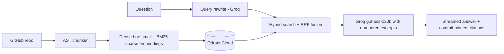

# RepoWhisperer: Codebase Q&A with Cited Answers

Ask questions about a codebase and get answers that cite the exact lines, pinned to a commit.
· Python · Qdrant · Groq · Streamlit


https://github.com/user-attachments/assets/b5c7a479-7382-4b1f-915d-2986fe4d85b0


## What it does

You pick a repository and ask a question in plain English. The app finds the relevant
functions and docs, streams an answer from an LLM, and links every claim to the exact
lines on GitHub. If the answer isn't in the code, it says so instead of guessing.

Indexed: `pallets/flask` (116 files, 817 chunks, evaluated) and `psf/requests` (same
pipeline, not benchmarked).

## Architecture



## Design decisions

- **AST chunking.** One chunk per function or method, a short overview chunk per class,
  and a context header (`# File:` / `# Symbol:`) on every chunk. Oversized functions
  are split into overlapping windows sized to the embedding model's 512-token limit.
- **Hybrid retrieval.** Dense (bge-small) and sparse (BM25) vectors in one Qdrant
  collection, fused with Reciprocal Rank Fusion, plus LLM-written query rewrites.
- **Citations can't be invented.** The model cites numbered excerpts; code maps each
  number to a real chunk and builds the GitHub permalink from stored metadata (repo,
  commit SHA, path, lines). Out-of-range numbers are ignored.
- **Grounded refusals.** The prompt requires an exact "I couldn't find this" sentence,
  which the evaluation detects programmatically.
- **Idempotent indexing.** Point IDs are derived from repo, commit, path, symbol and
  line, so re-indexing updates points instead of duplicating them.
- **Cost control.** Per-session and global daily question caps protect the free-tier
  API quota on a public deployment.

## Evaluation

38 questions about Flask (commit `d73fa1c`) in five types: direct (15),
vocabulary-mismatch (8), identifier lookup (6), docs-answerable (5), and negative (4,
answer absent from the repo; verified with a grep). Questions are split into **dev**
(used for design decisions) and **test** (run after the configuration was frozen).
Retrieval is scored with Hit@5 and MRR@5 against file-level gold labels.

### Retrieval

| Config | Dev Hit@5 | Dev MRR | Test Hit@5 | Test MRR |
|---|---|---|---|---|
| 0. Fixed-size chunks, dense | 75% | 0.61 | 90% | 0.61 |
| 1. AST chunks, dense | 88% | 0.76 | 100% | 0.82 |
| 2. + BM25 hybrid | 88% | 0.71 | 90% | 0.66 |
| **3. + query rewriting (default)** | 100% | 0.79 | 100% | 0.78 |
| 4. hybrid + cross-encoder reranker | 79% | 0.63 | not run | not run |
| 5. reranker + code-path prior | 88% | 0.71 | not run | not run |
| 6. rewrite + reranker + prior | 92% | 0.76 | not run | not run |

Dev n=24, test n=10, so one question is about 4 points on dev and 10 on test. Rows 4-6
are ablations that were evaluated on dev and rejected, not part of the shipped pipeline.

### Generation (gpt-oss-120b answers, gpt-oss-20b judge)

| | Dev (26 q) | Test (12 q) |
|---|---|---|
| Correct refusals on negatives | 2/2 | 2/2 |
| False refusals on answerable | 0/24 | 0/10 |
| Answers with a valid citation | 24/24 | 10/10 |
| Mean faithfulness (LLM judge) | 1.00 | 0.95 |

Refusals and citations are rule-based checks. Faithfulness uses a smaller same-family
LLM judge, so I validated it by injecting unsupported claims into real answers: it
flagged 5/5 fabricated claims and 4/5 true-but-ungrounded claims (n=5). Read the scores
as "no unsupported claims detected", a lower bound on leakage.

## Problems I faced and how I solved them

| # | Problem | Cause | Fix |
|---|---|---|---|
| 1 | Cloning Flask into my project made git stage ~250 files as an "embedded repository" | I cloned before ignoring `data/repos/`, then ran `git add .` | Unstaged it, added `data/repos/*` to `.gitignore` *before* cloning, and tested the rule with `git check-ignore`. I now check `git status` before every commit. |
| 2 | `pytest` crashed collecting Flask's own tests, and couldn't import my `ingest` package | Pytest searched every folder, including the cloned repo, and didn't add the project root to the import path | `pytest.ini` with `testpaths = tests`, `pythonpath = .`, and `norecursedirs = data venv` |
| 3 | The LLM call returned 404 `model_not_found` | Groq retired `llama-3.3-70b-versatile` mid-project | Queried Groq's models endpoint, switched to `gpt-oss-120b`, and moved the model name to an environment variable |
| 4 | Citations silently disappeared from the Sources list | The model wrote `【1】`, then `【3†L5-L7】`, instead of `[1]`, and my regex only matched `[1]` | Made the parser accept all bracket styles, tightened the prompt, and added a unit test. Citations are mapped to real chunks in code, so a model can't invent a source. |
| 5 | Long functions would have been silently truncated | The embedding model reads only 512 tokens, but I'd sized chunks for ~1,500 | Switched the limit to characters (2,000), and split oversized functions into overlapping windows |
| 6 | `retrieve()` returned `None` and the eval crashed | A pasted code edit dropped the final `return` | Replaced the function in full and checked it with the baseline eval before running anything else |
| 7 | The reranker made retrieval worse, and docs crowded out source code | A cross-encoder trained on web text prefers prose | Measured it as an ablation (Hit@5 88% to 79%), tried a path-based penalty, saw it cost the docs questions, and dropped the reranker from the pipeline |
| 8 | LLM query rewrites invented identifiers like `persist_login_state` | BM25 treats any token as a real search term | Told the rewriter not to invent identifiers, and cleared the rewrite cache (its key didn't include the prompt) |
| 9 | My first 15 eval questions couldn't tell the components apart (93% to 100%, one question's worth) | The set was small and all answers were in `src/`, so it favored whatever I tuned | Grew it to 38 questions in five types, added a held-out test split, and ran test once after freezing the configuration |
| 10 | A "negative" question wasn't actually negative | "GraphQL" appears in Flask's testing docs | Wrote `verify_dataset.py` to grep the corpus for each negative question's key terms, and replaced the question before running any evaluation |
| 11 | Re-running one eval config overwrote the others' saved results | Each run wrote the whole results file | Merged new rows into the existing JSON, and let `--only` accept several configs |
| 12 | The generation eval hit Groq rate limits: first per minute, then the 200,000 tokens/day cap, and lost 10 answers of progress | Each question costs about 7,000 tokens (answer plus judge), and results were saved only at the end | Saved after every question with resume support, stopped cleanly on the daily-limit error, paced requests, and moved the judge to a second model with its own quota |
| 13 | A perfect faithfulness score of 1.00 looked too good to trust | A small same-family LLM judge can be lenient | Validated the judge by injecting unsupported claims into real answers: it caught 5/5 fabricated claims and 4/5 true-but-ungrounded ones |
| 14 | A public demo would drain my free API quota | A per-session limit resets on every page refresh | Added a global daily question cap shared across sessions, plus input-length limits and friendly error messages for rate limits and index outages |

### Patterns I took from these

- **Measure before and after every change.** The reranker and the code-path penalty sounded right, and both failed when measured.
- **Distrust a result that looks too good.** The 93%-to-100% retrieval table and the 1.00 faithfulness score each needed a harder test before I believed them.
- **Validate data and tools, not only code.** Two of the worst problems were a mislabeled eval question and a lenient judge.
- **Make long jobs resumable.** Free-tier limits will interrupt anything long, so progress has to be saved incrementally.
- **Parse model output defensively.** Format drift is normal. Keep the parser tolerant and don't let the model be the source of truth for anything that can be verified in code.

## What I learned

1. **Chunk boundaries matter.** AST chunks beat same-size fixed windows (with the same
   header) on both splits. In one failure, a fixed window containing
   `DispatchingJinjaLoader` had no symbol name, so retrieval returned unrelated
   "dispatch" docs.
2. **Query rewriting helped where intended on dev** (vocabulary-mismatch questions went
   from 2/4 to 4/4), but the gain did not replicate on test, where dense retrieval
   already scored 4/4. It costs about 1-2 s per query.
3. **Hybrid search gave no measurable gain.** MRR dropped on both splits. Plausible
   causes: equal-weight RRF lets BM25 matches on common words dilute good dense hits,
   and the symbol header already carries identifier signal. Untested.
4. **An off-the-shelf reranker hurt.** A cross-encoder trained on web text ranked prose
   docs above source code (dev Hit@5 88% to 79%). A path-based prior fixed code
   questions but dropped docs questions to 0/2, so I dropped the reranker.
5. **Similarity scores can't decide "not found".** A negative question scored 0.761 on
   its top chunk while a correct positive scored 0.695, so refusal comes from a
   grounded prompt, not a score threshold.
6. **Models drift on citation format.** GPT-OSS emitted `【3†L5-L7】` instead of `[3]`.
   Citations are parsed with a tolerant regex and mapped to real chunks in code.
7. **The lowest-scoring answer pointed to a retrieval gap.** One answer (faithfulness
   0.67, identical under two prompts) stated true Flask behavior that wasn't in the
   retrieved excerpts. Tightening the prompt didn't fix it, so the cause is a missing
   chunk, not generation.
8. **Models get retired.** Groq removed `llama-3.3-70b-versatile` mid-project, so the
   model name lives in an environment variable.

## Limitations

- Small eval: only large effects are worth claiming. One repo, Python only.
- File-level gold labels count a hit if any chunk from the right file appears, even
  when the best evidence ranks lower or goes unused.
- The LLM judge is a smaller model from the same family as the generator.
- Query rewriting uses the LLM's prior knowledge of public repos, so its gain on a
  private codebase would likely be smaller.
- Single-turn Q&A; the free-tier demo is capped at 30 questions per day.

## Run it yourself

```bash
git clone <this repo> && cd repo-whisperer
python -m venv venv && source venv/bin/activate
pip install -r requirements-dev.txt
cp .env.example .env            # add GROQ_API_KEY, QDRANT_URL, QDRANT_API_KEY

python -m ingest.clone pallets/flask
python -m ingest.index --repo pallets/flask --path data/repos/flask --recreate
streamlit run app.py

python -m eval.run_eval --split dev -v          # retrieval ablation
python -m eval.answers_eval --split test        # refusals, citations, faithfulness
```

Use `--recreate` only for the first repo; it wipes the collection.

## Next steps

Weighted rank fusion, neighbor-chunk expansion for split functions, a per-file cap on
results, symbol-level gold labels, multi-turn chat, and tree-sitter for other languages.
